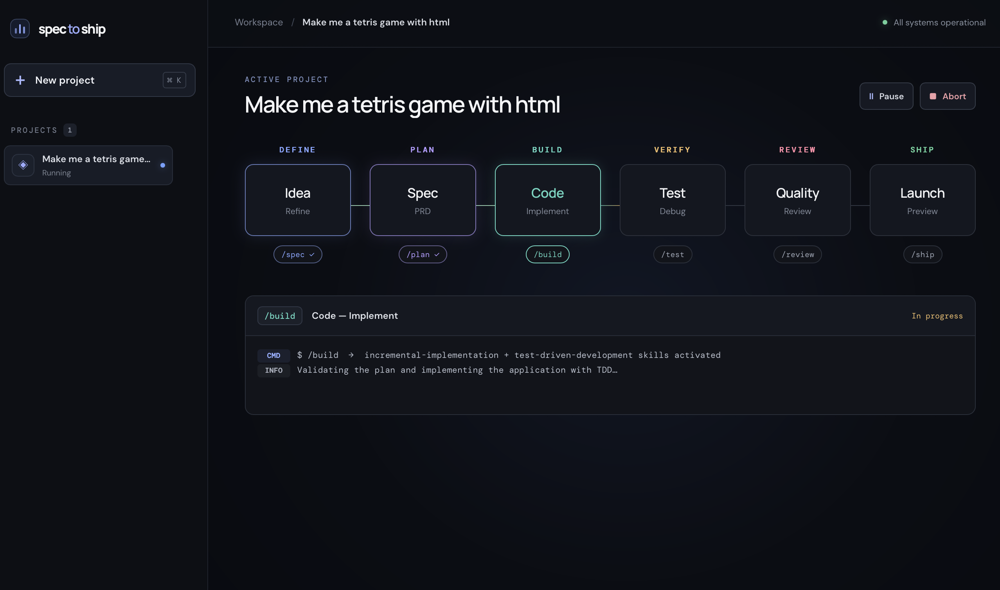
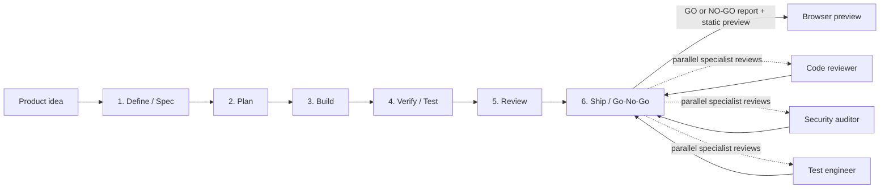
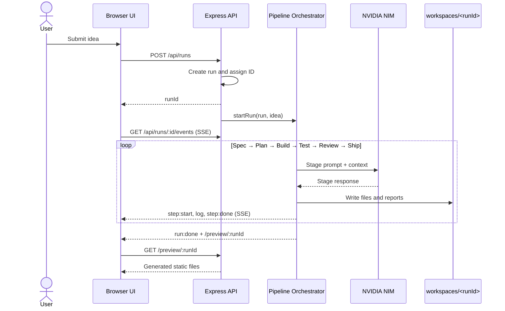

# Spec to Ship



**Spec to Ship** is an agentic software-development prototype that turns a product idea written in natural language into a specification, implementation plan, working web application, tests, and quality reports, with a browser-based preview of the result.

Instead of sending one large code-generation request, the system runs the idea through a six-stage, inspectable workflow:



## Purpose and hypotheses

This project explores whether the path from an idea to a working software prototype can be orchestrated through a single interface. It makes the following hypotheses visible and testable:

1. **Is a staged workflow more inspectable than one-shot code generation?** Each stage produces a defined artifact, making the hand-off to the next stage observable.
2. **Can prompts and engineering guidance steer the generated work?** Separate instructions guide specification, planning, implementation, testing, review, and the ship decision.
3. **Can multiple specialist perspectives form a useful quality gate?** At the ship stage, the same change is independently reviewed for code quality, security, and test coverage; the orchestrator then combines the results.
4. **Can the workflow be observable and controllable while it runs?** Stage events stream live to the UI, and a running pipeline can be paused, resumed, or aborted.
5. **Can an end-to-end prototype be produced from idea through verification?** Generated source code, tests, and reports are stored as separate files, and the application is previewed through the local server.

This is a **research and prototyping tool**, not proof that automatically generated software is safe for production. The quality of test and review results depends on the model, the clarity of the idea, and the quality of generated tests. The `/ship` GO decision is not a production deployment or a substitute for human approval. The application is served as a static preview by the local Express server; it does not deploy to the cloud.

## Agentic architecture

“Agentic” here does not mean a distributed system of independent agents that autonomously start processes and use tools. The primary actor is the **orchestrator** in `server/pipeline.js`: it executes a fixed sequence of stages, loads the relevant guidance for each stage, calls the model, and passes generated outputs to subsequent stages.

The agent behavior is composed from three layers:

- **Commands** (`pipeline-assets/commands/`): orchestration instructions describing each stage's goal, expected output, and behavior in this prototype.
- **Skills** (`pipeline-assets/skills/`): stage-specific engineering methods, such as the TDD loop, breaking work into small tasks, or conducting a five-axis code review.
- **References and specialist personas** (`pipeline-assets/references/`, `pipeline-assets/agents/`): checklists and role prompts that define focused review perspectives.

For each LLM request, the orchestrator adds the relevant command/skill/reference text to the `system` message, and adds working context—such as the idea, specification, plan, source files, or test results—to the `user` message. This gives the model a bounded task for each stage rather than asking it to reinterpret the entire project on every call. LLM requests go to NVIDIA NIM's OpenAI-compatible Chat Completions API.

### Stage-by-stage flow

| Stage | Orchestrator action | Model input | Output |
|---|---|---|---|
| **1 — Define / Spec** | Converts the idea into structured requirements. | Idea + `spec` command + `spec-driven-development` skill | `SPEC.md` |
| **2 — Plan** | Breaks the spec into small, dependency-ordered tasks. | Idea + spec + `planning` command + planning skill + Definition of Done | `tasks/plan.md`, `tasks/todo.md` |
| **3 — Build** | Generates application files; may make focused completion requests for missing required files. | Idea + spec + plan + build command + incremental implementation and TDD skills | `index.html`, `style.css`, `logic.js`, `app.js` |
| **4 — Verify / Test** | Generates tests for the application logic and runs the Node test runner. Test failures do not stop the pipeline; the report is passed to review. | Application logic and code + test command/skill + testing patterns | `test/logic.test.js` and test output |
| **5 — Review** | Reviews the code and test output across correctness, readability, architecture, security, and performance. | Generated files + test results + review guidance and security/performance checklists | `REVIEW.md` |
| **6 — Ship** | Calls three specialist roles in parallel, combines their reports, and creates a GO/NO-GO report. | The same idea, files, and test results are sent to each role; their reports are then provided to the synthesizer. | `SHIP_REPORT.md` and a preview link |

> **Parallelism boundary:** The code reviewer, security auditor, and test engineer at `/ship` are not separate processes or separate model providers. They are three independent calls to the same LLM service, each with a different persona/system prompt (`Promise.all`). Afterward, the orchestrator makes a fourth model call to synthesize the reports. Specialists do not call one another or share state.

### Event and data flow



The server streams stage and log events to the browser using Server-Sent Events (SSE). It can replay the event history from the in-memory run record while the same server process is running. Pause/resume takes effect at pipeline checkpoints between stages or model operations; an in-flight model request may need to finish before a pause takes effect. Abort is forwarded to the active model request through an `AbortSignal`. Run records are held in server memory, while generated files persist under `workspaces/<runId>/`. Restarting the server does not restore old run API records or event history.

## Prompt asset sources

Commands, skills, references, and specialist persona prompts are maintained in the tracked, application-owned [`pipeline-assets/`](pipeline-assets/README.md) directory. This avoids a runtime dependency on an ignored local vendor checkout.

The source ideas and adapted material for these guides draw on [`addyosmani/agent-skills`](https://github.com/addyosmani/agent-skills). The files here are a curated and adapted subset for this application's six-stage workflow, not a verbatim mirror of the upstream repository. License information is included in [`pipeline-assets/LICENSE`](pipeline-assets/LICENSE).

## Features

- A separate project/workspace and preview for each idea.
- Multiple pipelines can be started within the same Node.js server process.
- Live stage and log streaming, with pause, resume, and abort controls.
- Bounded retries for empty or transient model errors; format-recovery attempts for file-oriented responses such as plans, builds, and tests.
- Path validation that prevents generated files from being written outside their run workspace.
- The project list is stored in browser `localStorage` and can be cleaned up from the sidebar; backend pipeline run records are held in memory.
- Projects left in a `Running` state after a server restart are detected as unavailable and marked failed instead of remaining stuck indefinitely.

## Getting started

Requirements: Node.js and npm.

```bash
npm install
cp .env.example .env   # Add your NVIDIA_API_KEY to .env
npm start
```

Then open [http://localhost:3000](http://localhost:3000). If the API key is not configured, the server starts, but requests to start a new pipeline are rejected.

### Model configuration

- API: NVIDIA NIM, OpenAI-compatible `https://integrate.api.nvidia.com/v1`
- Default model: `nvidia/nemotron-3-super-120b-a12b`
- Set `LLM_MODEL` in `.env` to use a different model.
- Model calls are non-streaming. Transient network/429/5xx errors and empty responses are retried a limited number of times.

### Tests

```bash
npm test
```

This runs generated-file path safety checks, the API-key-free mock pipeline test, and the fallback test for unformatted model responses. The mock test verifies orchestration across all six stages; it does not validate real NVIDIA model quality or the production readiness of generated applications.

## Project structure

```text
pipeline-assets/
  commands/          # Orchestration prompts for the six pipeline stages
  skills/            # Stage-specific engineering methods
  agents/            # Three specialist persona prompts for /ship
  references/        # Shared quality and ship checklists
server/
  index.js            # Express API, SSE, run controls, and preview server
  llm.js              # NVIDIA NIM client and retry behavior
  pipeline.js         # Six-stage orchestrator, prompt composition, and file generation
public/
  index.html          # Workspace UI
  style.css           # UI styles
  app.js              # Project list, run controls, and SSE client
workspaces/           # Generated applications and reports per run (not tracked by git)
test-pipeline-*.js    # Mock, fallback, and security checks
```
